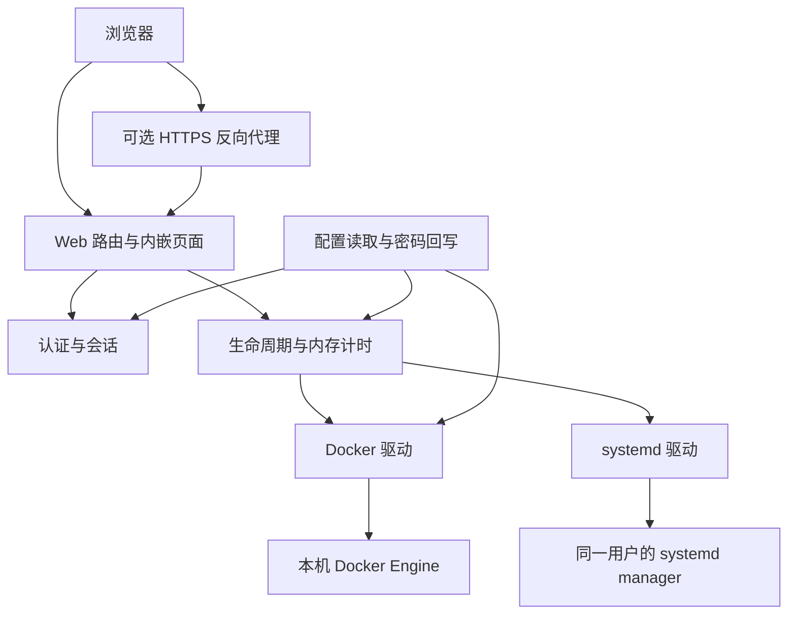

# GameHelm 2.0 设计方案

本方案记录本次架构讨论的最终决定，工作分支为 `2.0`，基于 `main` 的 `300ba12`。2.0 使用独立的配置和部署约定，按新安装设计。本文中的包名、配置字段、接口安排和安全参数是据此补齐的实现建议。

**产品范围。** GameHelm 作为 Linux 主机上的 Go 单进程程序运行，由同一普通用户的 systemd user manager 托管。内嵌简体中文 Web 界面统一管理该用户的 systemd 服务，以及一个本机 Docker Engine 中明确配置的现有容器。适用于 Web 应用、后台任务、开发环境和游戏服务器。每个服务支持状态查询、启动、停止、限时运行、续时和无限运行。管理员负责通过 Docker 或 Compose 准备服务容器。

**计时的最终决定。** 截止时间、续时次数、本轮时长策略、运行实例标识和操作进度全部保存在进程内存中。GameHelm 每次启动都按当前配置重新接管仍在运行的服务，给予完整运行时长并清零续时次数。此前讨论过的跨重启恢复截止时间、到期后持续保持运行和计时文件方案已由本条取代。

例如，服务 12:00 开始运行四小时，GameHelm 在 14:00 重启并发现它仍在运行，新截止时间为 18:00。如果 GameHelm 到 17:00 才恢复并发现它，新的截止时间为 21:00。配置为无限运行的服务按无限运行接管。

**架构。** HTTP 层处理认证、请求和展示，控制层统一管理服务生命周期，运行时驱动封装 Docker 和 systemd。配置模块负责启动时读取、校验与密码回写。计时和操作记录归控制层所有。



| 位置 | 职责 |
| --- | --- |
| `cmd/gamehelm` | 保留命令行入口和 `-config`、`-check` 参数 |
| `internal/app` | 组装依赖，管理启动、信号和退出 |
| `internal/config` | 解析新配置、应用默认值、校验、原子回写认证配置 |
| `internal/auth` | Argon2id、会话、CSRF 与登录限速 |
| `internal/control` | 服务实例识别、内存计时、续时、按服务串行执行操作 |
| `internal/runtime` | 公共目标与快照类型，以及 Docker、systemd 驱动 |
| `internal/web` | HTTP 路由、状态响应、内嵌 HTML/CSS/JavaScript |

运行时接口围绕 `Inspect`、`Start`、`Stop` 建立。查询结果包含标准化状态、明确的目标标识、本次运行标识和观察时间。控制层持有各服务对应的驱动，并只依赖统一快照。驱动记录经去敏处理的具体错误。`Run` 与 `Check` 复用配置解析、校验和驱动构造。

**Docker 驱动。** 使用官方 Go 客户端，通过配置中的 Unix socket 调用 Engine API，并启用 API 版本协商。依赖版本在实现时锁定到 `go.mod` 和 `go.sum`，与项目 Go 工具链一起验证。socket 是显式配置，连接目标由该字段决定。[Docker Go SDK](https://docs.docker.com/reference/api/engine/sdk/)

容器配置采用完整名称。接受启停请求时查询并核对返回的容器名称，将操作绑定到完整容器 ID 与当时的运行标识。执行前再次查询该 ID，发现目标被替换或本轮运行已经变化时终止过期操作，再刷新面板。本轮运行由容器 ID 与 `StartedAt` 共同识别。Compose 重建、手动重启或 Docker 自动重启产生新的运行实例时，从首次确认运行开始新计时。重复点击已经运行的同一实例的启动按钮保持原计时。[Docker Compose 重建行为](https://docs.docker.com/reference/cli/docker/compose/up/)

推荐使用同一用户的 Rootless Docker socket。管理员也可以明确配置常规 Docker socket，其访问权限包含宿主机 root 级能力。安装流程要求管理员自行准备 socket 访问权限。应用内的容器白名单约束可发起的操作。[Rootless Docker](https://docs.docker.com/engine/security/rootless/) · [Docker 用户组权限](https://docs.docker.com/engine/install/linux-postinstall/#manage-docker-as-a-non-root-user)

停止沿用容器或 unit 配置的停止信号与宽限期。提交操作前重新确认目标和运行实例。Docker 查询与停止属于独立调用，因此同一容器在外部并发重启时仍存在检查与执行之间的竞态，验收应覆盖可检测的实例变化和同名容器替换。[Docker 停止行为](https://docs.docker.com/reference/cli/docker/container/stop/)

**systemd 驱动。** 沿用 `systemctl --user` 参数化调用，管理配置中的完整 `.service` unit 名称。读取状态时同时取得 `InvocationID`，用它识别每轮运行。systemd 为新的运行周期分配新的标识，控制层据此识别两次轮询之间发生的重启。[systemd 运行标识](https://www.freedesktop.org/software/systemd/man/latest/systemd.exec.html#%24INVOCATION_ID)

**生命周期规则。** 配置在 GameHelm 启动时加载。本进程内每轮服务运行使用接管时的时长策略。管理员修改文件后，通过重启 GameHelm 加载新配置，此时全部运行中的服务依最终重启规则重新接管。

| 事件 | 处理 |
| --- | --- |
| Web 启动成功并确认运行 | 从首次确认时刻开始一轮计时 |
| 首次发现外部启动 | 按当前配置接管，续时次数为零 |
| 服务运行实例改变 | 清理上一轮记录，确认新实例运行后重新接管 |
| 同一实例再次收到启动请求 | 返回当前状态，保留本轮截止时间 |
| 进入最后一个续时时段 | 允许在原截止时间上增加一个续时时长 |
| 本进程内计时到期 | 确认同一实例仍在运行后发起停止 |
| 停止结果尚未确认 | 保留本轮记录，继续查询实际状态 |
| 确认服务停止 | 结束本轮计时并清理续时记录 |
| 运行时暂不可达或目标暂缺失 | 显示异常，保留原记录，等待重新确认 |
| 故障恢复并确认仍为同一运行实例 | 继续原计时，若已到期则发起停止 |
| GameHelm 重启 | 从首次确认运行时按最新配置开始完整新计时 |
| GameHelm 停机 | 服务由原运行时托管，停机前已提交的停止请求仍可能完成 |

有限运行时长默认 `4h`，续时默认 `1h`，最小时长为 `5m`。续时长度必须小于有限运行时长。`infinite` 表示无限运行。明确填写空字符串、`null` 或非法时长均视为配置错误。无限运行的续时按钮隐藏，若配置填写续时长度，仍校验其格式和最小值。

**操作与界面。** 每个服务使用独立的串行操作通道。启动、停止、续时与自动到期处理在同一服务上有明确顺序。跨服务的运行时查询和启停独立进行，按后端分配并发额度并设置超时，确保失联的 Docker 查询无法占满 systemd 的执行额度。后台操作绑定应用生命周期，浏览器刷新或请求结束后继续执行。

沿用 `GET /api/status` 和 `POST /api/services/{id}/{action}` 的入口形状。启动和停止接受后返回 `202`，状态响应包含操作进度，前端通过轮询更新。已满足目标状态时返回当前结果，正在执行的同一操作可复用进度，相冲突的请求返回 `409`。续时在单次串行操作中校验窗口并更新内存，成功返回 `200`。状态接口读取快照，避免被某个长时间停止操作阻塞。

界面主要显示「运行中」「已停止」「启动中」「停止中」「异常」。目标不存在和运行时不可达统一显示「异常」，具体原因写入日志。Docker 的暂停、损坏等无法正常管理的状态也显示异常。仅在确认实例和可控运行状态后执行到期操作。Docker 的运行状态与 systemd 的活动状态用于判断运行，操作结果以重新查询为准。

配置结构错误或认证配置失败会阻止启动。单个运行时不可用允许面板启动，可用服务继续工作。`-check` 汇总全部目标的配置和运行时检查结果，有任何异常时以失败状态退出。

**配置结构建议。** 配置支持带 // 和 /* */ 注释的 JSON，按 Web、认证、Docker 连接和服务列表分组。public_origin 和 trusted_proxies 为可选字段，示例默认注释，直接使用 HTTP 和 IP 即可访问。管理员需要填写自己的口令和实际目标。首次密码回写只替换活动口令字段的键和值，保留注释、其他字段与原有排版。

```jsonc
{
  "web": {
    "listen": "0.0.0.0:8231"
    // ,"public_origin": "https://games.example.com"
    // ,"trusted_proxies": ["127.0.0.1/32", "::1/128"]
  },
  "auth": {
    "password": ""
  },
  "docker": {
    "socket": "/run/user/1000/docker.sock"
  },
  "services": {
    "webapp": {
      "display_name": "Web 应用",
      "runtime": "docker",
      "container": "webapp",
      "run_duration": "4h",
      "extension_duration": "1h"
    },
    "worker": {
      "display_name": "后台任务",
      "runtime": "systemd",
      "unit": "worker.service",
      "run_duration": "infinite"
    }
  }
}
```

`runtime` 决定必填的目标字段，拒绝与该运行方式冲突的字段。相同 socket 下的容器名、相同用户下的 unit 必须唯一。仅配置 systemd 时可以省略 Docker 配置。服务 ID、名称和时长沿用现有校验习惯，显示顺序保持稳定。新 schema 严格校验未知字段、重复 JSON 键和尾随内容。旧配置中的 `state_file` 字段由新 schema 的未知字段检查拒绝。

**密码处理。** 管理员在 `auth.password` 填写初始口令，程序完成静态配置校验后生成随机盐和 Argon2id 哈希，在开始 HTTP 监听前原子改写为 `auth.password_hash`。这两个字段互斥。哈希结果包含算法版本、成本参数、盐和摘要。认证模块通过 `golang.org/x/crypto/argon2` 校验口令，并使用常量时间比较摘要。[Go Argon2 实现](https://pkg.go.dev/golang.org/x/crypto/argon2)

安全参数的实现基线采用 Argon2id v19、64 MiB 内存、3 次迭代、4 路并行、16 字节随机盐和 32 字节摘要。登录散列并发设定上限，输入与哈希解析均限制长度和成本，避免畸形配置或大量请求导致无界资源使用。口令建议最低 12 个 Unicode 字符、最高 1024 字节，拒绝空值与示例弱口令。实现验收包含目标服务器上的散列耗时与内存测量。[RFC 9106](https://www.rfc-editor.org/rfc/rfc9106.html)

配置改写在同一目录中创建权限为 `0600` 的临时文件，写入完整新配置、同步、原子替换，再同步目录。目录必须由运行用户控制且可写。任一步失败则启动退出并报告去敏后的错误。使用独立于待替换文件的实例锁协调同一配置的并发启动，进程持有锁至退出。管理员在停止 GameHelm 后编辑配置，启动时检测到并发修改则拒绝覆盖。

认证回写完成后，长期认证状态保存哈希，启动流程释放明文引用并缩短明文驻留时间。日志、错误响应和页面只输出去敏信息。已有合法哈希时启动直接使用。`-check` 验证结构和成本参数并检查运行时，整个过程保持只读。更换密码时用新的 `auth.password` 替换哈希字段，再重启 GameHelm，原有内存会话随重启失效，服务按最终计时规则重新接管。

**Web 访问。** 默认监听 `0.0.0.0:8231`，支持局域网通过 HTTP 和 IP 直接访问。`public_origin` 可选，配置时按指定来源校验请求，省略时使用请求实际的协议与 Host。`trusted_proxies` 可选，省略时使用连接来源地址。会话与登录 CSRF Cookie 使用 `HttpOnly`、`SameSite=Strict`，显式 HTTPS 来源或直接 TLS 连接时启用 `Secure`，Cookie 创建和清除使用一致属性。保留 POST CSRF 校验、CSP、登录失败限速和登出能力。[OWASP 会话管理指南](https://cheatsheetseries.owasp.org/cheatsheets/Session_Management_Cheat_Sheet.html)

只接受来自配置中可信代理的客户端地址转发头，代理须覆盖客户端自行提供的地址头。其他来源按实际连接地址处理。密码处理前执行请求体长度限制、登录限速和散列并发限制。会话存于内存，实现建议使用 30 分钟空闲超时和 12 小时绝对时限，清理过期会话和限速记录。

**部署与交付。** 提供 Linux `amd64`、`arm64` 二进制、新配置示例、systemd user unit 和 HTTPS 反代配置示例。安装流程要求管理员准备自己的口令，配置文件为 `0600`，配置目录支持启动时原子替换。日志继续交给 systemd user journal。安装时区分配置错误与目标暂不可达，后者通过诊断报告呈现并允许面板提供服务。发布使用明确的 2.0 版本号和校验文件。

**实施顺序与完成条件。** 每一步通过对应验收后进入下一步。

| 步骤 | 交付与验收 |
| --- | --- |
| 1. 配置与边界拆分 | 新 schema、统一驱动接口和 `Run`/`Check` 装配，现有 systemd 启停与续时经正常入口可用 |
| 2. 生命周期 | 纯内存计时、实例识别、异步操作，覆盖浏览器断开、重复请求、到期与手动操作竞争 |
| 3. Docker | Unix socket 驱动、名称核对、完整 ID 操作，容器重建与自动重启触发新计时 |
| 4. 密码与 Web 安全 | Argon2id 回写、失败即退出、只读检查、HTTPS Cookie、可信代理与资源限制 |
| 5. 界面与部署 | 混合服务列表、统一异常状态、进度显示、新安装流程及反代示例 |
| 6. 集成验收 | Linux 上通过实际 HTTP 登录与 API 操作一次性 Docker 容器和 systemd 用户服务 |

验收应至少覆盖以下用户可观察结果。

- GameHelm 重启后有限服务重新获得完整时长、续时归零，停机期间经过的旧截止时间随旧内存记录结束。
- 当前配置从限时改无限、从无限改限时及改变时长后，重启按新配置接管运行中的服务。
- GameHelm 持续运行时，同一服务的外部重启、Docker 自动重启和同名容器重建开启新一轮，续时严格遵守窗口。
- Docker 中断不阻塞 systemd 服务。恢复后，同一实例继续原内存计时，新实例重新接管。
- 目标缺失和运行时不可达均显示异常，API 和日志的敏感内容经过过滤。
- 慢停止期间其他服务的状态查询与操作继续完成。停止超时或结果不明时保持待确认状态。
- 明文首次启动完成哈希回写，重复启动使用哈希。只读检查保持文件内容和权限，回写失败时 HTTP 端口未开放。
- 畸形哈希、过高成本、认证字段冲突、重复键和错误后端字段在配置检查中被拒绝。
- 并发登录受到资源约束，CSRF、HTTPS Cookie、来源和可信代理校验经 HTTP 测试验证。

复用现有测试的时钟和运行时替身，扩展能覆盖新行为的回归用例。沿用 `go test -race ./...`、格式检查、模块一致性检查、lint、构建和 JavaScript 语法检查。增加 Linux Docker 集成验证，并在真实 systemd user manager 下验证启停及实例识别。页面移动时同步更新现有 CI 中的 JavaScript 路径。

**部署验收。** 部署前确认目标主机上的服务运行用户和安装目录，并准备可回滚备份。部署后使用 ego-browser 验收 HTTP + IP 登录、列表、启停、续时、无限运行、异常提示和退出，并核对移动端布局。验收记录使用通用环境说明，实际连接信息由部署管理员单独保管。
